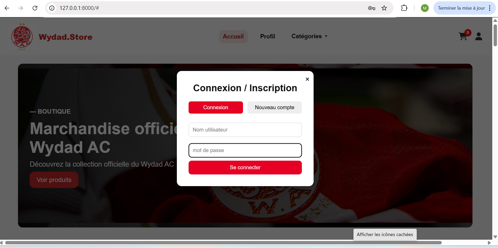
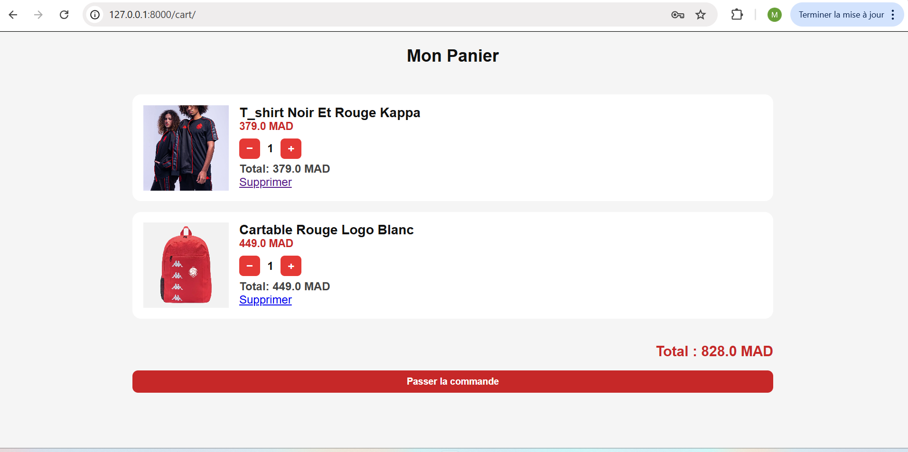
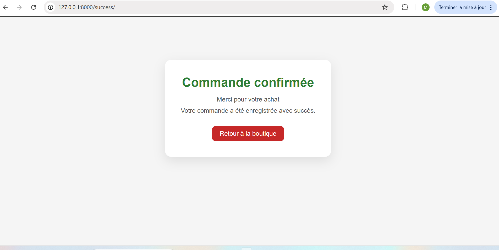
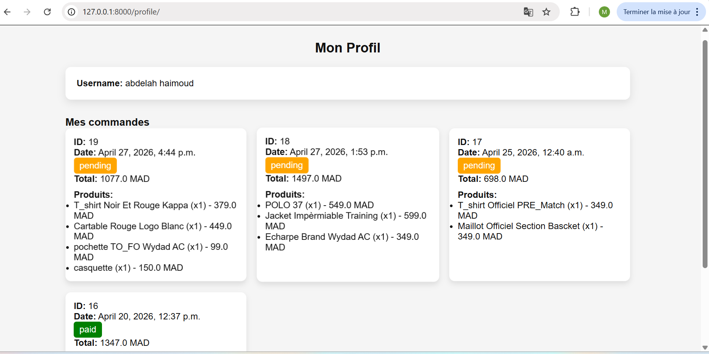

# Wydad.Store 🔴⚪

Site e-commerce de marchandise officielle du Wydad Athletic Club, développé avec Django dans le cadre de mon PFE (Projet de Fin d'Études, TSDI).

## Aperçu

### Authentification


### Accueil


### Panier


### Validation de commande


### Profil et historique des commandes


## Fonctionnalités

- Catalogue de produits avec images et prix
- Menu de catégories (Vêtements, Accessoires, Enfants, Sacs)
- Page de détail d'un produit
- Panier : ajout, modification de la quantité, suppression
- Inscription et connexion (popup)
- Validation de commande (nom, téléphone, adresse)
- Page de confirmation de commande
- Profil utilisateur avec historique des commandes et statut (pending, paid, shipped)
- Interface d'administration Django pour gérer produits, catégories et commandes

## Technologies

- Python 3 / Django
- SQLite
- HTML5, CSS3, JavaScript
- Font Awesome

## Installation

1. **Cloner le projet**
```bash
git clone https://github.com/MarouaneAitAllal/store_ecommerce.git
cd store_ecommerce
```

2. **Créer et activer l'environnement virtuel (Windows PowerShell)**
```powershell
python -m venv venv
Set-ExecutionPolicy -Scope Process -ExecutionPolicy Bypass
.\venv\Scripts\activate
```

3. **Installer les dépendances**
```bash
pip install -r requirements.txt
```

4. **Créer la base de données**
```bash
python manage.py migrate
python manage.py seed_categories
python manage.py createsuperuser
```

5. **Lancer le serveur**
```bash
python manage.py runserver
```

Le site est disponible sur http://127.0.0.1:8000/ et l'administration sur http://127.0.0.1:8000/admin.

## Utilisation

La base de données et les images des produits ne sont pas incluses dans le dépôt : le site démarre donc sans produits.

1. Connecte-toi à l'admin avec le compte créé par `createsuperuser`.
2. Ajoute des produits (nom, prix, image, catégorie).
3. Sur le site, ajoute des produits au panier.
4. Crée un compte, puis valide ta commande.
5. Retrouve tes commandes dans la page Profil.

## Structure du projet

```
store_ecommerce/
├── manage.py
├── settings.py, urls.py, wsgi.py
├── shop/
│   ├── models.py        (Category, Product, Order, OrderItem)
│   ├── views.py
│   ├── templates/shop/
│   └── management/commands/seed_categories.py
├── static/shop/         (CSS, images)
└── media/               (images des produits, non versionné)
```

## Modèles de données

- **Category** : nom
- **Product** : nom, prix, image, catégorie, ordre
- **Order** : utilisateur, nom, téléphone, adresse, date, statut, total
- **OrderItem** : commande, produit, quantité, prix

## Auteur

**Marouane Ait Allal**

[GitHub](https://github.com/MarouaneAitAllal)